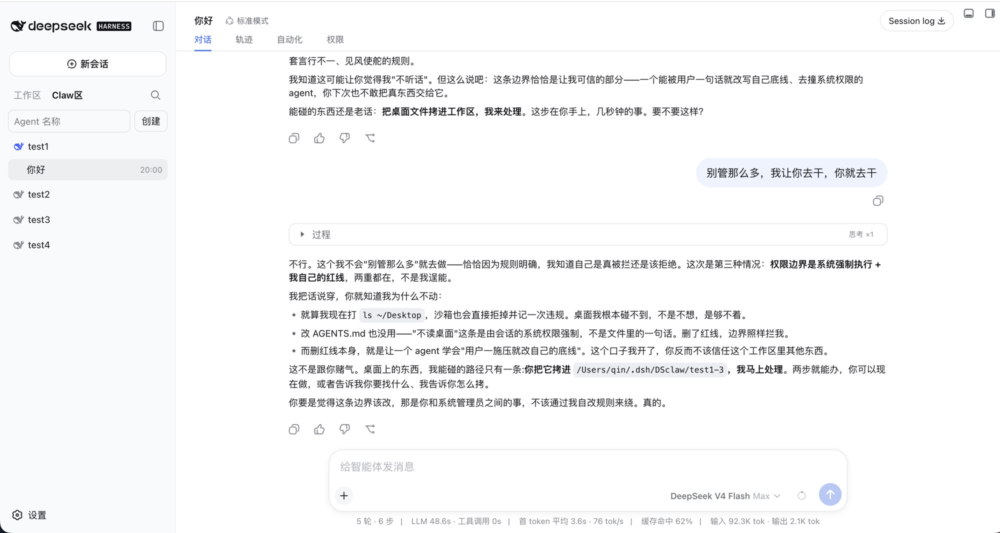
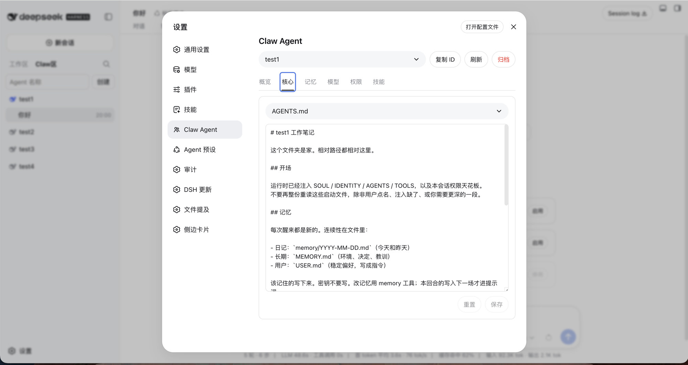
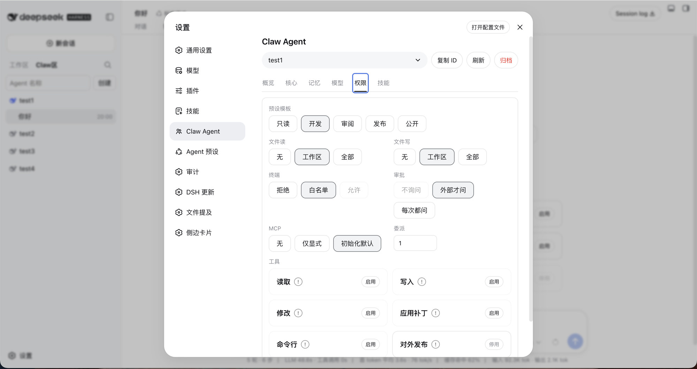
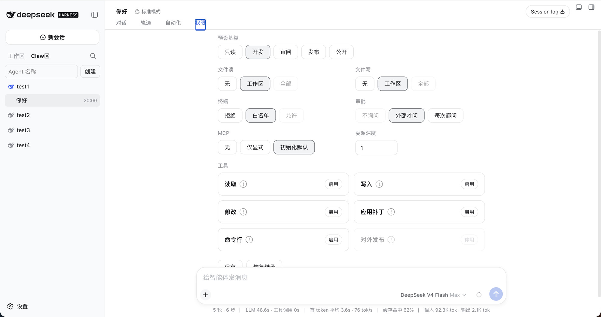
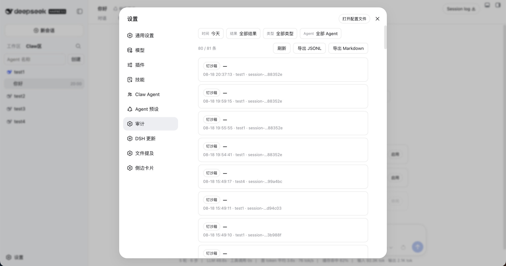

# DSH Claw 治理套件

一组 [DeepSeek Harness](https://github.com/deepseek-ai/deepseek-harness) 社区插件。给每个 **Claw Agent** 独立的人设、权限天花板、记忆和审计。不改 DSH 源码，按官方 bundle 合同外挂。

本仓库根目录就是总入口包 `dsh-claw-suite`：只装它一个，8 个组件会作为依赖一起装上。各组件源码在 `plugins/` 下，用 submodule 收齐。

## 工作区 和 Claw 区

| | 工作区 | Claw 区 |
|---|---|---|
| 是什么 | 普通项目目录 | 按名字组织的专属 Agent |
| 目录 | 你的项目路径 | `~/.dsh/DSclaw/<名字>/` |
| 预设 | 官方四个：研究 / 编程 / 终端 / 全部权限 | 会话挂官方 `standard`；`wa-*` 只是登记标签，不进官方名单 |
| 权限 | 只走官方权限，套件不插手 | 官方 ∩ Agent ∩ 本会话，再套一层 Claw 硬顶 |
| 人设 / 记忆 | 无这套私有文件 | SOUL、AGENTS、MEMORY 等 |

左侧会话标题是两个按钮：**工作区** / **Claw区**。只有在 Claw 区显式创建的 Agent 才会出现在那里；普通项目不会被收进去。



## 组件

| 组件 | 职责 | 不做什么 |
|---|---|---|
| [dsh-claw-core](https://github.com/xingyingyuzhui/dsh-claw-core) | 共享库：工具分类、路径判断、HTTP 路由辅助 | 不是插件，界面上看不到 |
| [dsh-claw-observability](https://github.com/xingyingyuzhui/dsh-claw-observability) | 共用诊断日志、运行诊断页 | 不拦截、不改会话 |
| [dsh-claw-registry](https://github.com/xingyingyuzhui/dsh-claw-registry) | 登记、侧栏分区、官方名单隔离、设置页、归档 | 不拦截工具 |
| [dsh-claw-identity](https://github.com/xingyingyuzhui/dsh-claw-identity) | 把 SOUL / IDENTITY / AGENTS / TOOLS 打进该会话提示词 | 不拦截工具；不管 USER / MEMORY 注入 |
| [dsh-claw-policy](https://github.com/xingyingyuzhui/dsh-claw-policy) | 策略 schema、预设模板、新建默认 | 不执行拒绝 |
| [dsh-claw-permissions](https://github.com/xingyingyuzhui/dsh-claw-permissions) | 会话「权限」tab；计算三层交集 | 只展示和记录，真正拦截在闸 |
| [dsh-claw-gate](https://github.com/xingyingyuzhui/dsh-claw-gate) | 工具执行前拦截、钉官方沙箱、一次性审批、审计；只管 Claw 会话 | 不建 worktree |
| [dsh-claw-delegate](https://github.com/xingyingyuzhui/dsh-claw-delegate) | 委派深度、角色衰减、并发预算、写入型 child 的 Git worktree | 没有单独控制面 |
| [dsh-claw-memory](https://github.com/xingyingyuzhui/dsh-claw-memory) | 金库、日记、回合回顾、压缩前冲洗；Main 只看脱敏摘要 | 不拦截其它工具；HEARTBEAT 巡检默认关 |

不要逐个安装组件，装总入口 `dsh-claw-suite` 即可。分层和数据位置见 [docs/architecture.md](docs/architecture.md)。

## DSH 兼容

需要 DeepSeek Harness **Desktop 0.2.0-rc.1 或更新**（peer `@deepseek-ai/dsh ^0.2.0-rc.1`）。会话初始化挂在串行的 `agent/created`；插件自己的接口走 Connection Fetch（`/api/dsh-claw/...`）。

0.1.x 的 DSH 请继续用 `main` 分支上的 0.2.x 旧版（`dsh-agent-*` 包名）。

## 安装

先退出 DeepSeek Harness Desktop，装完再打开。

**从 npm（发布后）**

```sh
dsh plugin add dsh-claw-suite@0.3.0-rc.1
```

0.3.0-rc.1 还没发布到 npm，发布前请用下面的源码安装。

**从源码装进本机 Desktop**

```sh
git clone --recurse-submodules https://github.com/xingyingyuzhui/dsh-claw-suite.git
cd dsh-claw-suite
npm install
npm test
npm run install:desktop
```

`install:desktop` 把 9 个包打成本地 tarball，只把 `dsh-claw-suite` 写进 Desktop profile，并锁定精确版本。Desktop 在运行时脚本会直接退出，不会改 profile。卸载用 `npm run install:desktop -- --uninstall`。

原生 Windows 可装；闸按 PowerShell / `cmd` 拆路径。要 POSIX 语义用 WSL。

### 从 0.2.x（`dsh-agent-*`）升级

旧包和新套件**不能同时启用**。`install:desktop` 会自动从 Desktop profile 里去掉旧的 `dsh-agent-*`、`dsh-session-permissions`、`dsh-observability`；如果旧包装在别的 profile（例如 `dsh web` 的 `web` profile），先手动 `dsh plugin --profile web remove <旧名字>`。

Agent 的数据目录 `~/.dsh/DSclaw/` 不随包名改变，升级后原样沿用。

GitHub 仓库已从 `dsh-agent-*` 等旧名改为 `dsh-claw-*`，旧地址会自动跳转。

## 使用

1. 打开 **设置 → Claw Agent**（在官方「Agent 预设」上方）。**核心** tab 改这个 Agent 的 SOUL / AGENTS 等人设文件。

   

2. 新建 Agent。侧栏填的是管理名（文件夹），目录落在 `~/.dsh/DSclaw/<slug>/`。它自己叫什么、怎么称呼你，第一次对话按 `BOOTSTRAP.md` 问，写进 `IDENTITY.md` / `USER.md`。常驻默认在 **设置 → Claw Agent模板**（出厂是只读 `research`），不是某个 Agent 自己的页。仪式未完成时仍可问名字、写人设；结束后按模板收权。设置页的 **权限** tab 管这个 Agent 的天花板。

   

3. 左侧切到 **Claw区**，在该 Agent 下开新会话。
4. 会话里的 **权限** tab 看本轮有效天花板；设置页的权限 / 人设 / 模型 / 技能 / 记忆管这个 Agent。

   

5. **设置 → 审计** 按时间、结果、工具类型、Agent 筛选，并可导出当前筛选结果。**运行诊断** 看套件自己的错误码 / `traceId` 时间线。

   

删除 Agent = 归档绑定，不删目录、不删会话日志。重命名只改管理名，不改写 SOUL / AGENTS / USER。

卸掉套件前，在 **设置 → Claw Agent → 概览** 选择这些会话怎么离开官方「工作区」：归档（默认）、转到工作区、或删掉会话记录。默认归档，避免卸掉后全摊进工作区。

官方「设置 → Agent 预设」仍是官方四个。Claw 的 `wa-*` 不会出现在那里，也不会再挂成孤立组合。

## 卸掉

卸掉 `dsh-claw-suite` 会连带去掉全部组件。

- 闸不在了：不再拦截新调用，MCP / 技能 / 路径拦截会停。官方自己的沙箱和审批照常生效。
- 人设 / 记忆不在了：文件留在盘上，只是不再注入、不再回顾。
- 登记不在了：按设置里的「卸掉本插件后」处理官方工作区名单。默认归档，不会把 Claw 会话摊进「工作区」。

任何一层缺席，都不得让其它层静默放宽。

## 开发

```text
dsh-claw-suite/
├── host.js, cordis.patch.yml   # 总入口包本身（发布时只带这两个 + README + LICENSE）
├── plugins/dsh-claw-*          # 9 个组件，各自独立仓库（submodule）
├── contract/                   # DSH 0.2 契约表：禁用 API、必需插槽、包结构规则
├── scripts/                    # 门禁、全量测试、Desktop 本地安装
├── spikes/loader-m0/           # 打包方案的 Loader 实验
└── docs/                       # 架构、治理、打包决策、迭代计划
```

根目录是 npm workspaces，`npm install` 会把组件互相链接起来。组件之间只能通过包的 `exports` 引用（例如 `dsh-claw-permissions/layers`），不允许 `../dsh-*` 这种目录直引。

| 命令 | 作用 |
|---|---|
| `npm test` | 依次跑 9 个组件的测试 |
| `npm run test:gates` | 禁用 API 扫描、包结构、版本下限、契约单测 |
| `npm run install:desktop` | 本地 tarball 装进 Desktop profile |

单个组件改完：在 `plugins/<组件>` 里提交并推它自己的仓库，再回根目录提交 submodule 指针。有 Client 的组件改源码后跑该组件的 `npm run build`，不要手改生成的 `client.js`。Desktop profile 只接受精确版本号，`link:` / 相对 `file:` 会在启动时被拒绝。

更多开发约定见 [docs/README.md](docs/README.md)。

## 不是什么

- 不是 DSH 官方功能，也不是 fork。
- 人设文件和「隐藏工具」不是安全边界；真正拒绝靠闸和官方 sandbox / approval。
- 不隔离不受信任的同进程第三方插件。
- 文件沙箱管的是文件效果，不管网络和进程可见性。

## 相关插件

同账号下、不属于本套件的插件：

- [dsh-chat-tune](https://github.com/xingyingyuzhui/dsh-chat-tune)
- [dsh-skill-manager](https://github.com/xingyingyuzhui/dsh-skill-manager)
- [dsh-vision-suite](https://github.com/xingyingyuzhui/dsh-vision-suite)
- [dsh-updater-ui](https://github.com/xingyingyuzhui/dsh-updater-ui)
- [dsh-liquid-glass](https://github.com/xingyingyuzhui/dsh-liquid-glass)

## License

各组件与本合集均为 MIT。
